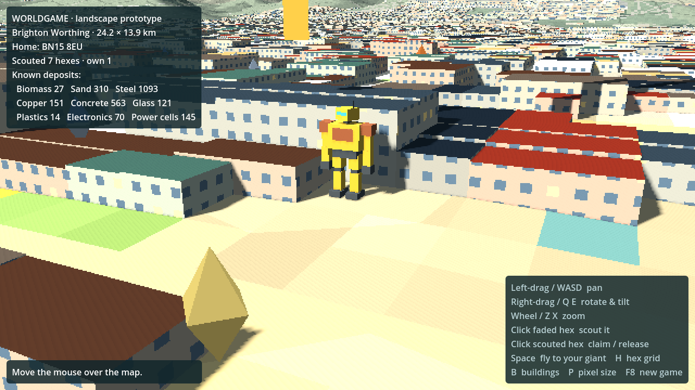
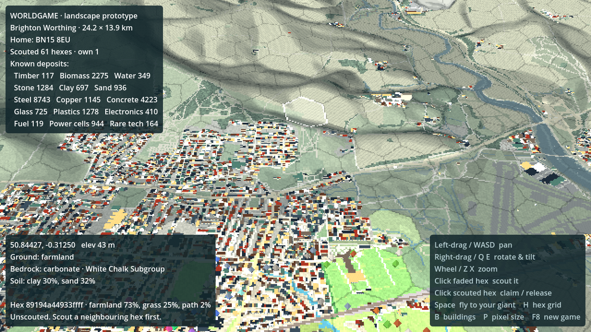

# WorldGame

An online multiplayer world game set on the real map. It takes place in the near future, after an apocalyptic event. Players type in an address, postcode or place name anywhere in the world, claim a hex of land as their home, and send out 40 ft (12 m) AI-driven giants that scout and salvage resources from the real landscape.

Built so far:
- the **landscape generator**: real-world map data turned into a pixel-art 3D world in Godot;
- **resources and scouting**: fixed deposits that each player only sees once they've scouted a hex. The prototype region runs from **Worthing to Brighton, between the sea and the South Downs**, centred on home postcode **BN15 8EU** (Lancing).


| Brighton Palace Pier | A 12 m giant among Lancing houses | Scouted hexes with deposits |
| --- | --- | --- |
|  |  |  |

## How it works

```
place ──► tools/mapgen/generate.py ──► godot/data/regions/<name>/ ──► Godot builds the 3D world
          (Python: download + rasterize)   (compact grid layers)       (GPU terrain, buildings, hexes)
```

1. **Region generator** (`tools/mapgen/`, Python): works **anywhere on Earth**. It geocodes the place, downloads open map, elevation, geology and soil data for the area, and rasterizes it into a ~10 m grid. Each cell gets:
   - a terrain height,
   - a land-cover class (sea, beach, water, urban, park, farmland, wood, road, rail, building and others),
   - a building height,
   - bedrock geology and soil clay/sand content,
   - the global **H3 hex** it belongs to.
   
   It writes these as small gzipped layers plus `meta.json`, and saves map and geology previews to `docs/`.
2. **Godot landscape** (`godot/`, Godot 4.5, GDScript, Compatibility renderer so it can export to the web):
   - **Terrain:** 256 × 256-cell chunks, displaced on the GPU from the height texture and coloured per cell from the land-cover palette, with banded lighting and a pixel hillshade. Height is exaggerated 2× so the Downs read clearly.
   - **Buildings:** one `MultiMesh` per chunk, with a box for each run of building cells. Each building gets its real height (from OpenStreetMap), a roof colour, and walls with windows.
   - **Pixel-art look:** the 3D view renders at ½ resolution (P cycles 1–4×) and is scaled up with nearest-neighbour filtering.
   - **Hex grid:** global [H3](https://h3geo.org) hexes (resolution 9, about 350 m across), so every hex has the same permanent worldwide id in every region. Borders follow the pixel grid. Your home hex is gold, with a beacon and your first giant.
3. **Resources and scouting** (`godot/scripts/deposit_generator.gd`, `world_state.gd`): see below.

## Resources and scouting

There are 15 raw resources, all real-world materials, so AI agents can reason about them without game-specific knowledge:

| Group | Resources | Where they come from |
| --- | --- | --- |
| Land | timber, biomass, water, stone, clay, sand | woods; grassland and farmland; rivers and wetland; **bedrock** (hard rock such as granite, basalt, chalk or sandstone gives stone); **soil** (clay-rich and sandy soils); beaches |
| Salvage | steel, copper, concrete, glass, plastics, electronics | buildings (scaled by volume), industrial and commercial land, railways, roads |
| Special | fuel, power cells, rare tech | **real sites** from OpenStreetMap: fuel stations, EV chargers, car parks, garages, recycling centres, hospitals, colleges, railway stations, airfields |

- **Deterministic:** deposits in a hex are generated from a secret world seed plus the hex's global H3 id and the real landscape, so the same hex always produces the same deposits. Nothing is stored until it's seen.
- **Once seen, fixed:** scouting a hex freezes what was found, with a timestamp, in the player's save (`user://worldgame_save.json`, keyed by H3 id, so it carries across regions). Hovering shows "scouted 5 min ago". Later, others may have stripped it since.
- **Fog of war:** the landscape is public, but resources are only visible in hexes you've scouted. Unscouted land is faded; hexes next to your scouted area are less faded and can be scouted next.
- **Territory:** you start with your home hex plus its six neighbours scouted. You can claim scouted hexes that touch your own land. Hexes that run off the edge of a region can't be scouted, because their landscape isn't fully known.
- **Server-ready:** in multiplayer the generator runs only on the server, so the seed never reaches players and the resource map can't be extracted from the game files.

## Run it

1. Install [Godot 4.5+](https://godotengine.org/download) (standard build; no .NET needed).
2. Open `godot/project.godot` and press **Play** (F5). The Brighton–Worthing region is already generated and committed.

| Input | Action |
| --- | --- |
| Left-drag, WASD / arrows | Pan |
| Right-drag (or Shift + left-drag), Q / E | Rotate and tilt |
| Mouse wheel, Z / X | Zoom |
| Click a faded hex next to your area | Scout it (reveals its deposits) |
| Click a scouted hex | Claim it (if it touches your land) / release it |
| Space / Home | Fly to your giant |
| H | Toggle hex grid |
| B | Toggle buildings |
| P | Cycle pixel size |
| F8 | New game (clears scouting and claims) |

Tests (headless): `godot --headless --path godot --script res://tests/test_deposits.gd`

Dev helpers, for screenshots or CI:
`godot --path godot -- --region=res://data/regions/<name> --reset --scout-radius=3 --view=x,z,yaw_deg,pitch_deg,distance --giant-view=yaw,pitch,dist --hover=px,py --screenshot=out.png`

## Generate another region (anywhere)

Needs Python 3.10+: `pip install -r tools/mapgen/requirements.txt` (numpy, Pillow, h3).

```sh
# The committed prototype region
python3 tools/mapgen/generate.py --place "BN15 8EU" \
    --bbox=-0.43,50.795,-0.085,50.92 --name brighton_worthing

# Anywhere: an address, postcode or place name, 3 km around it
python3 tools/mapgen/generate.py --place "Montmartre, Paris" --radius-km 3 --name montmartre
python3 tools/mapgen/generate.py --place "Shibuya, Tokyo" --radius-km 3 --name shibuya
```

Then set `region_path` on the `Main` node (or pass `-- --region=res://data/regions/<name>`). Options:
- `--cell` sets the target cell size (default 10 m).
- `--h3-res` sets the hex size (default 9).
- `--bbox` takes an explicit lon/lat box.
- Downloads are cached in `tools/mapgen/.cache/`.

Tested in Sussex, Reykjavik, Paris and Tokyo. A 3 km city region takes about 5 s; the 24 × 14 km Brighton–Worthing region takes about 20 s and is about 6 MB of data.

**Regions agree where they overlap.** Cells snap to a global lattice and hexes are global, so two overlapping regions see the same hex ids, the same soil and geology, and the same land cover (apart from a handful of pixels at the very edge of a region, which belong to unplayable edge hexes).

**Known data limits:**
- OpenStreetMap detail varies by country.
- SoilGrids has no data under dense cities; bedrock is used there instead.
- Elevation above 60° N/S comes from coarser sources than SRTM, so expect some artefacts (Iceland, for example).

**Web export:** add `data/*` to the export preset's *Filters to export non-resource files*, so the `.bin.gz` and `.json` layers are included.

## Data sources and attribution

The landscape is our own renderer, inspired by [UnoPixelMap / Pixel Atlas](https://github.com/wieslawsoltes/UnoPixelMap); no code from it is used. The data comes from open sources, and each one requires attribution in the game:

- Map data © [OpenStreetMap](https://www.openstreetmap.org/copyright) contributors (ODbL), via [OpenMapTiles](https://openmaptiles.org/) vector tiles served by [OpenFreeMap](https://openfreemap.org/).
- Elevation: [Mapzen Terrain Tiles](https://registry.opendata.aws/terrain-tiles/) on AWS Open Data (SRTM and other sources).
- Bedrock geology: [Macrostrat](https://macrostrat.org) (CC-BY 4.0) and its source maps (e.g. BGS, USGS, the Global Lithological Map).
- Soil texture: [SoilGrids 2.0](https://soilgrids.org), ISRIC – World Soil Information (CC-BY 4.0).
- Geocoding: [Nominatim](https://nominatim.org) / OpenStreetMap (ODbL). UK postcodes: [postcodes.io](https://postcodes.io/), which contains OS data © Crown copyright and database right, and ONS data.
- Hex grid: [H3](https://h3geo.org) by Uber (Apache 2.0).

## Next steps (ideas)

- **Privacy:** before going multiplayer, place a player's home at a random hex near their postcode, not on it.
- **Server:** run the region generator server-side on demand when someone claims somewhere new, and stitch neighbouring regions together (hexes and data already line up).
- **Gameplay:** move the giant to scout and salvage instead of clicking, then give it rules in plain English.
- **Crafting:** about 20–25 items for the first version (raw → processed → components → giant parts and structures), using real-world logic (sand → glass, clay → brick, ore + charcoal → iron).
- **Depletion and regrowth:** salvage runs out, while biomass regrows and slowly reclaims towns.
