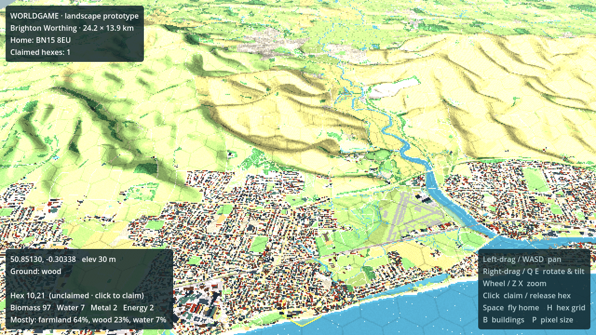
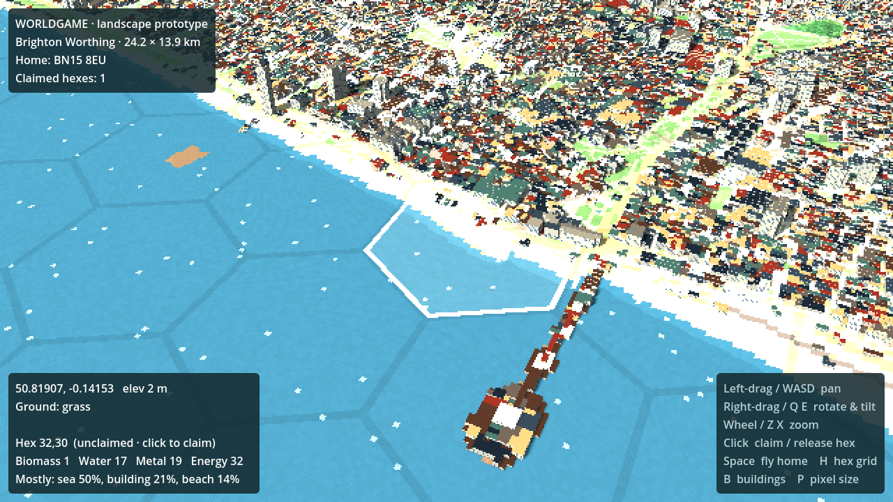
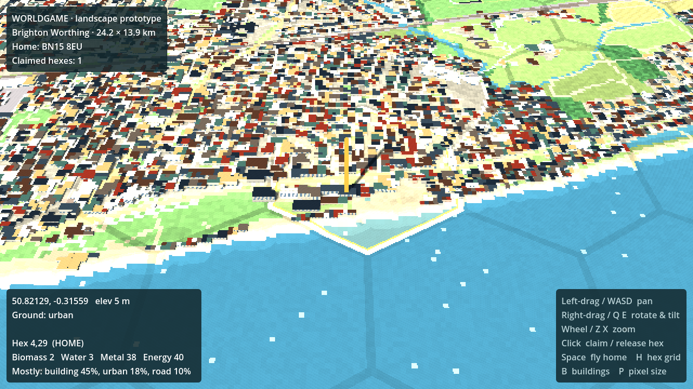
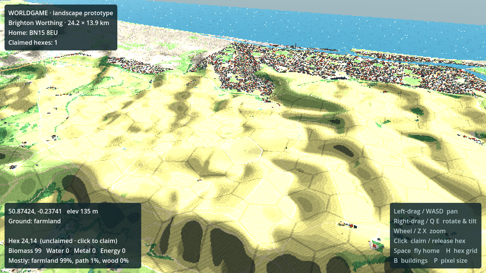

# WorldGame

An online multiplayer world game set on the real map. Players type in a postcode, claim a hex of land as their home, and send out AI bug/robot characters that gather resources from the real landscape.

This first milestone is the **landscape generator**: real-world map data turned into a pixel-art 3D world in Godot. The prototype region runs from **Worthing to Brighton, between the sea and the South Downs**, centred on home postcode **BN15 8EU** (Lancing).



| Brighton Palace Pier | Home hex (BN15 8EU) | South Downs looking south |
| --- | --- | --- |
|  |  |  |

## How it works

```
postcode ──► tools/mapgen/generate.py ──► godot/data/regions/<name>/ ──► Godot builds the 3D world
             (Python: download + rasterize)   (compact grid layers)       (GPU terrain, buildings, hexes)
```

1. **Region generator** (`tools/mapgen/`, Python): looks up the postcode, downloads open vector tiles and elevation tiles for the area, and rasterizes them into a 10 m grid. Each cell gets:
   - a terrain height,
   - a land-cover class (sea, beach, water, urban, park, farmland, wood, road, rail, building and others),
   - a building height.
   
   It writes these as small gzipped layers plus `meta.json`, and saves a preview PNG to `docs/`.
2. **Godot landscape** (`godot/`, Godot 4.5, GDScript, Compatibility renderer so it can export to the web):
   - **Terrain:** 256 × 256-cell chunks, displaced on the GPU from the height texture and coloured per cell from the land-cover palette, with banded lighting and a pixel hillshade. Height is exaggerated 2× so the Downs read clearly.
   - **Buildings:** one `MultiMesh` per chunk, with a box for each run of building cells. Each building gets its real height (from OpenStreetMap), a roof colour, and walls with windows.
   - **Pixel-art look:** the 3D view renders at ½ resolution (P cycles 1–4×) and is scaled up with nearest-neighbour filtering.
   - **Hex claim grid:** pointy-top hexes of 250 m. Your postcode's hex is your **home** (gold, with a beacon). Click other hexes to claim or release them. Hovering shows the hex's land-cover mix and **resources** (biomass, water, metal, energy). Resources are derived from land cover; the values are a first sketch, in `CLASSES` in `generate.py`.

## Run it

1. Install [Godot 4.5+](https://godotengine.org/download) (standard build; no .NET needed).
2. Open `godot/project.godot` and press **Play** (F5). The Brighton–Worthing region is already generated and committed.

| Input | Action |
| --- | --- |
| Left-drag, WASD / arrows | Pan |
| Right-drag (or Shift + left-drag), Q / E | Rotate and tilt |
| Mouse wheel, Z / X | Zoom |
| Click | Claim / release the hex under the cursor |
| Space / Home | Fly back to your home hex |
| H | Toggle hex grid |
| B | Toggle buildings |
| P | Cycle pixel size |

Dev helpers, for screenshots or CI:
`godot --path godot -- --view=x,z,yaw_deg,pitch_deg,distance --hover=px,py --screenshot=out.png`

## Generate another region

Needs Python 3.10+ with `numpy` and `Pillow` (`pip install numpy pillow`).

```sh
# The committed prototype region
python3 tools/mapgen/generate.py --postcode "BN15 8EU" \
    --bbox=-0.43,50.795,-0.085,50.92 --name brighton_worthing

# Any UK postcode, 4 km around it
python3 tools/mapgen/generate.py --postcode "SW1A 1AA" --radius-km 4 --name westminster
```

Then point `region_path` on the `Main` node (or in `scripts/main.gd`) at `res://data/regions/<name>`. Options:
- `--cell` changes the resolution: 10 m is the default, and 5 m gives finer buildings but 4× the data.
- `--bbox` takes any lon/lat box, which works worldwide; only postcode lookup is UK-only.
- Downloads are cached in `tools/mapgen/.cache/`.

The Brighton–Worthing region is 2424 × 1391 cells (24 × 14 km). It downloads 170 vector tiles and 15 elevation tiles, generates in about 30 s, and its data is about 4.7 MB.

**Web export:** add `data/*` to the export preset's *Filters to export non-resource files*, so the `.bin.gz` and `.json` layers are included.

## Data sources and attribution

The landscape is our own renderer, inspired by [UnoPixelMap / Pixel Atlas](https://github.com/wieslawsoltes/UnoPixelMap); no code from it is used. The data comes from open sources, and each one requires attribution in the game:

- Map data © [OpenStreetMap](https://www.openstreetmap.org/copyright) contributors (ODbL), via [OpenMapTiles](https://openmaptiles.org/) vector tiles served by [OpenFreeMap](https://openfreemap.org/).
- Elevation: [Mapzen Terrain Tiles](https://registry.opendata.aws/terrain-tiles/) on AWS Open Data (SRTM and other sources).
- Postcodes: [postcodes.io](https://postcodes.io/). Contains OS data © Crown copyright and database right, and ONS data.

## Next steps (ideas)

- **Privacy:** before going multiplayer, place a player's home at a random hex near their postcode, not on it.
- **Server:** run the region generator server-side on demand when someone claims somewhere new, and move to a global hex index (H3) so regions stitch together.
- **Gameplay:** resource nodes on the map, then the first bot that follows rules written in plain English.
